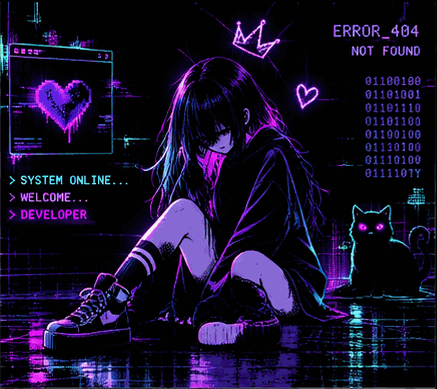

<div align="center">



<br/>


</div>

<br/>

<div align="center">

`[ ACCESS GRANTED ]` &nbsp; `[ SYSTEM ONLINE ]` &nbsp; `[ DEVELOPER MODE ]`

</div>

---

## `01 // ABOUT ME`

```text
> NAME       : Chaimae Sektaoui
> ROLE       : Computer Science Student
> LOCATION   : Morocco
> INTERESTS  : Programming / Technology
> STATUS     : Learning & Building...
```

## `02 // TECH STACK`

<div align="center">


</div>

## `03 // CURRENTLY WORKING ON`

```text
[+] Learning new technologies
[+] Developing programming projects
[+] Exploring web development
[+] Improving problem-solving skills
```

## `04 // GITHUB STATISTICS`

<div align="center">


<br/><br/>


</div>

---

<div align="center">


**`THINK DIFFERENT // CODE DIFFERENT`**

`01000011 01001000 01000001 01001001 01001101 01000001 01000101`

</div>
